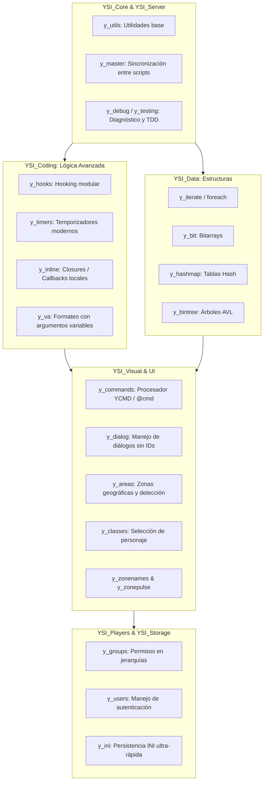

# Introducción a YSI v5

Bienvenido a la documentación técnica de **YSI (Y_Less's Standard Includes)**, el marco de desarrollo de scripts y librerías más avanzado, completo y optimizado para **SA-MP** (San Andreas Multiplayer) y **open.mp**.

Desarrollado originalmente por **Alex "Y_Less" Cole** y mantenido de forma activa por el equipo de **pawn-lang**, YSI expande drásticamente las capacidades del compilador Pawn estándar, dotando a los desarrolladores de herramientas de nivel profesional: estructuras de datos avanzadas, funciones en línea (*closures*), hooking modular sin conflictos de callbacks, sistemas de comandos de ultrabaja latencia, temporizadores precisos y abstracciones de interfaz gráfica y lógica de servidor.

---

## Tabla de Contenido

- [¿Qué es YSI?](#que-es-ysi)
- [¿Por qué usar YSI en lugar de código estándar?](#por-que-usar-ysi-en-lugar-de-codigo-estandar)
- [Arquitectura General de YSI v5](#arquitectura-general-de-ysi-v5)
- [Estructura de Carpetas y Módulos](#estructura-de-carpetas-y-modulos)
- [El Sistema YSI Master (YSI_Core\y_master)](#el-sistema-ysi-master-ysi-corey-master)
- [Compatibilidad con SA-MP y open.mp](#compatibilidad-con-sa-mp-y-open-mp)
- [Buenas Prácticas Iniciales](#buenas-practicas-iniciales)

---

## ¿Qué es YSI?

Pawn es un lenguaje simple de tipado débil, diseñado originalmente para sistemas embebidos. En el entorno de SA-MP clásico (0.3.7), los desarrolladores se encontraban limitados por:
- La imposibilidad de modularizar scripts (todos los callbacks como `OnPlayerConnect` debían concentrarse en un solo archivo o sufrir el infierno de encadenamiento manual mediante ALS).
- El costo exorbitante en CPU de bucles anidados sobre `MAX_PLAYERS` (que por defecto suele ser 500 o 1000 iteraciones en vacío).
- La falta de colecciones dinámicas seguras: no existían tablas hash nativas, listas enlazadas, mapas de bits compactos ni árboles balanceados.
- La duplicación de comandos y falta de control de accesos granular.

**YSI** es una suite modular de código abierto que soluciona cada una de estas carencias sin comprometer la velocidad en tiempo de ejecución. Al contrario, la inmensa mayoría de las características de YSI se resuelven en **tiempo de compilación** mediante el preprocesador de Pawn y análisis estático de macros ensambladas (*AMX bytecode injection*), garantizando una velocidad comparable a las funciones nativas en C++.

---

## ¿Por qué usar YSI en lugar de código estándar?

| Aspecto | SA-MP Nativo / Código Tradicional | Con YSI Includes (v5.x) |
| :--- | :--- | :--- |
| **Modularidad** | Todo el código de callbacks centralizado en un único gamemode gigantesco. | `y_hooks` permite declarar `HOOK__ OnPlayerConnect(playerid)` en 50 archivos distintos sin interferencias. |
| **Comandos** | Comparación lenta de cadenas con `strcmp` o procesadores arcaicos. | `y_commands` (`YCMD:` o `@cmd()`) emplea tablas hash con O(1) tiempo de resolución y control de grupos integrado. |
| **Temporizadores** | `SetTimerEx` con cadenas para tipos de datos, propenso a desbordamientos y fugas. | `y_timers` introduce sintaxis de lenguaje limpia: `defer MiFuncion(playerid)`, `repeat`, `task` y `ptask`. |
| **Iteraciones** | Bucles `for(new i = 0; i < MAX_PLAYERS; i++)` que analizan 1000 ranuras vacías. | `y_iterate` (`foreach (new i : Player)`) solo visita los IDs realmente conectados, reduciendo el coste de CPU en más del 95%. |
| **Estructuras de Memoria** | Arrays estáticos que desperdician megabytes de memoria de datos AMX. | `y_bit`, `y_hashmap`, `y_bintree` permiten compresión de datos a nivel de bit y búsquedas logarítmicas. |
| **Diálogos** | Manejo de IDs numéricos que colisionan entre filterscripts y gamemodes. | `y_dialog` asocia callbacks directos o funciones *inline* a cada diálogo sin preocuparse por los IDs. |

---

## Arquitectura General de YSI v5

YSI versión 5 supuso una reescritura masiva orientada a:
1. **Separación de responsabilidades**: Cada módulo puede incluirse individualmente o a través de submódulos (`#include <YSI_Visual\y_commands>`).
2. **Eliminación de colisiones**: Uso riguroso de espacios de nombres internos (`YSI_g_s*`, directivas ALS actualizadas).
3. **Decoradores modernos**: Transición paulatina de etiquetas arcaicas (como `YCMD:`) hacia decoradores semánticos modernos como `@cmd()`, `@test()`, `@hook()`.
4. **Soporte de Compiladores Modernos**: Totalmente optimizado para el compilador de la comunidad de Pawn (**pawn-lang/compiler** versión 3.10.11 o superior).



---

## Estructura de Carpetas y Módulos

Al integrar YSI en tu servidor, encontrarás las siguientes categorías en la carpeta de includes:

- **`YSI_Visual`**: Enfocado en la interacción con el usuario y la presentación gráfica (comandos de chat, diálogos dinámicos, áreas 3D de activación, nombres de zonas de GTA, pulso de gangzones en radar).
- **`YSI_Coding`**: Extensiones avanzadas del lenguaje Pawn (ganchos de callbacks modulares, temporizadores `task`/`ptask`/`defer`/`repeat`, invocaciones asíncronas, formato variable `va_format`).
- **`YSI_Data`**: Estructuras de datos de alta eficiencia en memoria y velocidad (iteradores `foreach`, arrays de bits, árboles binarios, hashmaps).
- **`YSI_Players`**: Agrupación de jugadores, control de acceso basado en roles (`y_groups`), localización e idiomas (`y_languages`, `y_text`).
- **`YSI_Storage`**: Sistemas de almacenamiento y lectura de archivos de configuración (`y_ini`), variables compartidas (`y_svar`, `y_uvar`) y manipulación interna de la máquina virtual AMX.
- **`YSI_Core`**: Módulos fundacionales compartidos por toda la suite: gestión del estado maestro (`y_master`), escudos de librerías (`y_als`) y macros auxiliares.

---

## El Sistema YSI Master (`YSI_Core\y_master`)

Una de las características más asombrosas y exclusivas de YSI es su **sistema maestro** (*YSI Master*). 

En SA-MP, el gamemode y cada filterscript se ejecutan en máquinas virtuales AMX completamente independientes y aisladas. Tradicionalmente, si registrabas un comando o una variable en un filterscript, el gamemode no tenía visibilidad directa sobre él sin recurrir a llamadas costosas con `CallRemoteFunction`.

El sistema **Master** de YSI unifica el ecosistema:
- Detecta automáticamente qué script se cargó primero y lo designa como el nodo maestro para cada subsistema (por ejemplo, el subsistema de comandos es el Master 51).
- Si el filterscript maestro se descarga mediante `/rcon unloadfs`, el sistema transfiere de forma segura y transparente la memoria y el control al siguiente script disponible sin reiniciar el servidor ni provocar fallos de segmentación (*crash*).
- Los comandos y permisos declarados en un filterscript se comunican sinérgicamente con el gamemode principal.

---

## Compatibilidad con SA-MP y open.mp

YSI v5 fue diseñado con una premisa fundamental: **máxima compatibilidad sin fisuras**:
- **SA-MP 0.3.7 / 0.3.DL**: Totalmente funcional utilizando el servidor estándar de SA-MP junto al plugin `sscanf2` y un compilador comunitario reciente (Community Pawn Compiler 3.10.11 o superior).
- **open.mp**: Total compatibilidad nativa. En open.mp, muchas correcciones que antes requerían `fixes2` vienen resueltas en el núcleo del servidor, y YSI detecta automáticamente el entorno de open.mp para aprovechar sus optimizaciones sin requerir parches adicionales.

---

## Buenas Prácticas Iniciales

1. **Utiliza siempre el compilador comunitario**: El compilador original de Pawn provisto con SA-MP en 2015 tiene múltiples bugs críticos (fallos al evaluar expresiones ternarias complejas, desbordamientos en macros largos). Descarga el compilador actualizado desde el repositorio oficial de [pawn-lang/compiler](https://github.com/pawn-lang/compiler).
2. **Incluye YSI después de las librerías nativas**:
   ```pawn
   #include <a_samp>
   // Si utilizas open.mp, incluye <open.mp> en lugar de <a_samp>
   #include <sscanf2>
   
   // Luego incluye los módulos de YSI que tu script necesite:
   #include <YSI_Visual\y_commands>
   #include <YSI_Visual\y_dialog>
   #include <YSI_Coding\y_timers>
   #include <YSI_Coding\y_hooks>
   ```
3. **No incluyas todo indiscriminadamente**: Aunque YSI optimiza la memoria no utilizada, incluye únicamente los submódulos que tu archivo realmente consume.
