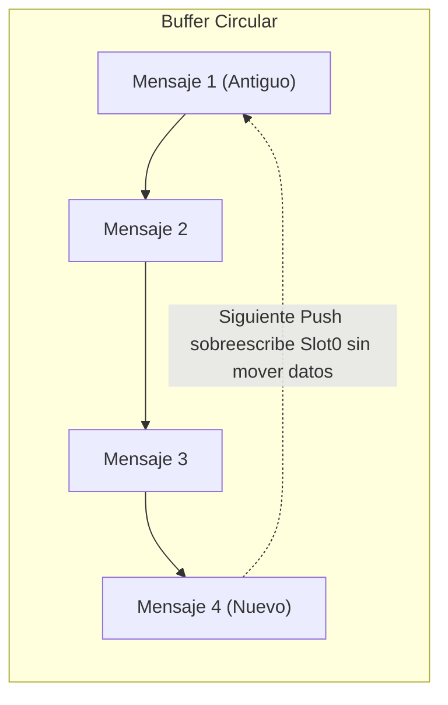

# Arrays Avanzados (y_sparsearray, y_sortedarray, y_circular)

La suite YSI incluye tres estructuras de datos especializadas para resolver problemas comunes de memoria, ordenamiento y colas de datos en SA-MP y open.mp:
1. **`y_sparsearray`:** Arrays dispersos para almacenar índices no contiguos sin desperdiciar memoria en slots vacíos.
2. **`y_sortedarray`:** Arrays auto-ordenados que mantienen los elementos en secuencia para búsquedas binarias $\mathcal{O}(\log N)$.
3. **`y_circular`:** Buffers circulares FIFO de rotación instantánea en memoria para historiales de chat, colas de mensajes y telemetría.

---

## Inclusión en el Proyecto

Puedes incluir cada módulo individualmente según las necesidades de tu proyecto:

```pawn
#include <YSI_Data\y_sparsearray>
#include <YSI_Data\y_sortedarray>
#include <YSI_Data\y_circular>
```

---

## Tabla de Contenidos

1. [Parte 1: y_sparsearray (Arrays Dispersos)](#parte-1-y_sparsearray-arrays-dispersos)
   - [Concepto y Ventajas](#concepto-sparsearray)
   - [Declaración y Sintaxis](#declaracion-sparsearray)
   - [Funciones de y_sparsearray](#funciones-de-y_sparsearray)
2. [Parte 2: y_sortedarray (Arrays Auto-Ordenados)](#parte-2-y_sortedarray-arrays-auto-ordenados)
   - [Concepto y Búsqueda Binaria](#concepto-sortedarray)
   - [Declaración y Sintaxis](#declaracion-sortedarray)
   - [Funciones de y_sortedarray](#funciones-de-y_sortedarray)
3. [Parte 3: y_circular (Buffers Circulares FIFO)](#parte-3-y_circular-buffers-circulares-fifo)
   - [Concepto y Rotación sin Copia](#concepto-circular)
   - [Declaración y Sintaxis](#declaracion-circular)
   - [Funciones de y_circular](#funciones-de-y_circular)
4. [Ejemplos Prácticos Completos](#ejemplos-practicos-completos)
5. [Buenas Prácticas y Errores Comunes](#buenas-practicas-y-errores-comunes)

---

## Parte 1: y_sparsearray (Arrays Dispersos)

### Concepto <a id="concepto-sparsearray"></a>

Imagina que necesitas asociar datos al ID de cuenta de los jugadores de tu base de datos MySQL, donde los IDs van del `1` al `500,000`, pero en tu servidor solo juegan 50 personas simultáneamente.

- En Pawn estándar, declarar `new g_Datos[500000];` consumiría **2 megabytes de memoria estática en el archivo AMX**, y el 99.9% de las celdas estarían vacías.
- `y_sparsearray` resuelve esto almacenando únicamente los índices que realmente contienen un valor, liberando la memoria cuando un slot se elimina (*sparse storage*).

### Declaración <a id="declaracion-sparsearray"></a>

```pawn
// Sintaxis: new SparseArray:Nombre<>;
new SparseArray:g_TelefonoJugador<>;
```

---

### Funciones de `y_sparsearray`

#### Sparse_Set

- **Tipo:** Macro preprocesador / Función interna
- **Descripción:** Establece un valor en un índice arbitrario del array disperso. Si el índice no existía, se crea dinámicamente.

```pawn
Sparse_Set(SparseArray:array<>, index, value);
```

```pawn
// Asignar el valor 1250 al índice 450000 sin reservar los 449999 slots previos:
Sparse_Set(g_TelefonoJugador, 450000, 1250);
```

---

#### Sparse_Get

- **Tipo:** Macro preprocesador / Función interna
- **Descripción:** Obtiene el valor almacenado en el índice indicado. Si el índice no existe, devuelve el valor por defecto especificado (por defecto `cellmin`).

```pawn
Sparse_Get(SparseArray:array<>, index, default = cellmin);
```

```pawn
new tel = Sparse_Get(g_TelefonoJugador, 450000, -1);
if (tel != -1)
{
    printf("Teléfono encontrado: %d", tel);
}
```

---

#### Sparse_TryGet

- **Tipo:** Función booleana
- **Descripción:** Intenta obtener el valor de un índice y lo almacena por referencia en la variable de destino.

```pawn
bool:Sparse_TryGet(SparseArray:array<>, index, &dest);
```

```pawn
new valor;
if (Sparse_TryGet(g_TelefonoJugador, 450000, valor))
{
    printf("El valor existe: %d", valor);
}
```

---

#### Sparse_Contains

- **Tipo:** Función booleana
- **Descripción:** Comprueba si un índice específico existe actualmente en el array disperso.

```pawn
bool:Sparse_Contains(SparseArray:array<>, index);
```

---

#### Sparse_UnSet

- **Tipo:** Macro preprocesador
- **Descripción:** Elimina el índice del array disperso y libera el espacio ocupado.

```pawn
Sparse_UnSet(SparseArray:array<>, index);
```

---

#### Sparse_Exchange

- **Tipo:** Función booleana
- **Descripción:** Lee el valor anterior de un índice, escribe un nuevo valor opcional y devuelve `true` si el slot existía previamente. Si no se suministra un nuevo valor, elimina el slot (análogo a `Sparse_UnSet` pero recuperando el valor previo).

```pawn
bool:Sparse_Exchange(SparseArray:array<>, index, &oldValue, newValue = cellmin);
```

---

## Parte 2: y_sortedarray (Arrays Auto-Ordenados)

### Concepto <a id="concepto-sortedarray"></a>

`y_sortedarray` es una estructura en la que los elementos se insertan en su posición correspondiente de forma automática mediante inserción ordenada (*insertion sort* con desplazamiento en memoria vía `memcpy`).

Dado que la colección permanece ordenada de menor a mayor en todo momento, las comprobaciones de existencia y localización de índices se realizan mediante **búsqueda binaria** en tiempo $\mathcal{O}(\log N)$, en lugar de búsquedas secuenciales $\mathcal{O}(N)$.

```mermaid
graph LR
    subgraph Búsqueda Binaria O(log N)
        A["[10, 25, 40, 55, 70, 85, 99]"] --> B["Comprobar Punto Medio (55)"]
        B --> C["Si Buscado > 55: Descartar Mitad Izquierda"]
        C --> D["Espacio Reducido a la Mitad"]
    end
```

### Declaración <a id="declaracion-sortedarray"></a>

```pawn
// Sintaxis: new SortedArray:Nombre<CAPACIDAD>;
new SortedArray:g_PuntajesAltos<50>;
```

---

### Funciones de `y_sortedarray`

#### Sorted_Add

- **Tipo:** Macro preprocesador / Función stock
- **Descripción:** Inserta un nuevo valor en el array, desplazando los elementos contiguos para mantener el orden ascendente.

```pawn
bool:Sorted_Add(SortedArray:arr<>, value);
```

#### Retorno
Devuelve `true` si el elemento fue insertado con éxito, o `false` si el array ya alcanzó su capacidad máxima.

```pawn
Sorted_Add(g_PuntajesAltos, 500);
Sorted_Add(g_PuntajesAltos, 120);
Sorted_Add(g_PuntajesAltos, 850);
// El array internamente queda ordenado: [120, 500, 850]
```

---

#### Sorted_Remove

- **Tipo:** Macro preprocesador / Función stock
- **Descripción:** Busca el elemento mediante búsqueda binaria y lo retira del array, reajustando el tamaño y compactando los elementos restantes.

```pawn
bool:Sorted_Remove(SortedArray:arr<>, value);
```

#### Retorno
Devuelve `true` si el elemento fue localizado y removido; `false` si no existía.

---

#### Sorted_Contains

- **Tipo:** Macro preprocesador / Función stock
- **Descripción:** Comprueba si un valor se encuentra en el array mediante búsqueda binaria $\mathcal{O}(\log N)$.

```pawn
bool:Sorted_Contains(SortedArray:arr<>, value);
```

```pawn
if (Sorted_Contains(g_PuntajesAltos, 500))
{
    print("El puntaje 500 está registrado.");
}
```

---

#### Sorted_Find

- **Tipo:** Macro preprocesador / Función stock
- **Descripción:** Devuelve la posición de índice donde se encuentra almacenado el valor dentro del array ordenado.

```pawn
Sorted_Find(SortedArray:arr<>, value);
```

#### Retorno
Devuelve el índice entero ($\ge 0$), o `-1` si no se encuentra.

---

## Parte 3: y_circular (Buffers Circulares FIFO)

### Concepto <a id="concepto-circular"></a>

Un **buffer circular** (o array rotativo FIFO) es una estructura de datos con capacidad fija en la que los elementos más antiguos se descartan automáticamente cuando ingresan nuevos datos una vez alcanzada la capacidad máxima.

En Pawn tradicional, implementar un historial de los últimos 10 mensajes requería ejecutar `memcpy` o un bucle `for` desplazando 9 mensajes hacia la izquierda cada vez que alguien escribía.

### La Innovación de `y_circular`
`y_circular` manipula directamente los punteros de desplazamiento de la cabecera del array bidimensional en el AMX. La rotación se produce **de forma instantánea en $\mathcal{O}(1)$ sin copiar ni mover los datos ya existentes**.



### Declaración <a id="declaracion-circular"></a>

Se declara como un array bidimensional convencional donde la primera dimensión es la **capacidad máxima de elementos** y la segunda es el **tamaño de cada elemento o cadena**:

```pawn
#define CAPACIDAD_HISTORIAL (10)
#define TAMANO_MENSAJE      (128)

// 10 mensajes de hasta 128 caracteres cada uno
new g_HistorialChat[CAPACIDAD_HISTORIAL][TAMANO_MENSAJE];
```

---

### Funciones de `y_circular`

#### Circular_Init

- **Tipo:** Macro preprocesador
- **Descripción:** Inicializa las estructuras internas y los desplazamientos de memoria AMX del array circular. Debe llamarse antes de usar el buffer.

```pawn
Circular_Init(array[][]);
```

```pawn
public OnGameModeInit()
{
    Circular_Init(g_HistorialChat);
    return 1;
}
```

---

#### Circular_Push

- **Tipo:** Macro preprocesador / Función interna
- **Descripción:** Agrega un nuevo elemento o cadena al buffer circular. Si el buffer está lleno, sobreescribe automáticamente el elemento más antiguo y rota la cabecera.

```pawn
Circular_Push(array[][], data[]);
```

#### Retorno
Devuelve el slot interno en el que fue almacenado el elemento.

```pawn
stock RegistrarMensajeEnHistorial(const texto[])
{
    Circular_Push(g_HistorialChat, texto);
}
```

---

#### Circular_Count

- **Tipo:** Macro preprocesador
- **Descripción:** Devuelve cuántos elementos válidos contiene actualmente el buffer (desde 0 hasta su capacidad máxima).

```pawn
new totalMensajes = Circular_Count(g_HistorialChat);
```

---

#### Circular_Capacity

- **Tipo:** Macro preprocesador
- **Descripción:** Devuelve la capacidad total de almacenamiento del buffer (`sizeof(array)`).

```pawn
new capacidad = Circular_Capacity(g_HistorialChat); // Devuelve 10
```

---

#### Circular_Full

- **Tipo:** Macro preprocesador
- **Descripción:** Indica si el buffer ha alcanzado su capacidad máxima y comenzará a rotar elementos viejos en los siguientes ingresos.

```pawn
if (Circular_Full(g_HistorialChat))
{
    // El buffer está lleno al 100%
}
```

---

## Ejemplos Prácticos Completos

### Ejemplo 1: Historial de Comandos de Administrador con `y_circular`

```pawn
#include <openmultiplayer>
#include <YSI_Data\y_circular>
#include <YSI_Visual\y_commands>

#define MAX_LOG_COMANDOS (8)
#define MAX_LEN_COMANDO  (128)

// Buffer circular de los últimos 8 comandos ejecutados en el servidor
new g_HistorialAdmin[MAX_LOG_COMANDOS][MAX_LEN_COMANDO];

public OnGameModeInit()
{
    Circular_Init(g_HistorialAdmin);
    return 1;
}

// Función que registra un comando auditado
stock AuditarComando(playerid, const cmdtext[])
{
    new entrada[MAX_LEN_COMANDO];
    new nombre[MAX_PLAYER_NAME];
    GetPlayerName(playerid, nombre, sizeof(nombre));
    
    format(entrada, sizeof(entrada), "[LOG] %s: %s", nombre, cmdtext);
    // Push instantáneo en O(1) rotando el más viejo
    Circular_Push(g_HistorialAdmin, entrada);
}

// Comando para ver los últimos comandos registrados
YCMD:verultimoscomandos(playerid, params[], help)
{
    if (GetPlayerScore(playerid) < 5) return SendClientMessage(playerid, 0xFF0000AA, "No autorizado.");

    new total = Circular_Count(g_HistorialAdmin);
    if (total == 0)
    {
        return SendClientMessage(playerid, 0xFFFF00AA, "No hay comandos en el historial reciente.");
    }

    SendClientMessage(playerid, 0x33CCFFAA, "--- Últimos comandos ejecutados en el servidor ---");
    for (new i = 0; i < total; i++)
    {
        SendClientMessage(playerid, 0xFFFFFFFF, g_HistorialAdmin[i]);
    }
    return 1;
}
```

---

### Ejemplo 2: Ranking de Top Killers con `y_sortedarray`

```pawn
#include <openmultiplayer>
#include <YSI_Data\y_sortedarray>

// Mantiene hasta 20 marcas de bajas ordenadas numéricamente
new SortedArray:g_TopKills<20>;

stock RegistrarBajaCompetitiva(totalKills)
{
    // Se inserta manteniendo el orden de forma automática
    if (!Sorted_Add(g_TopKills, totalKills))
    {
        // Si el array está lleno, verificar si supera al menor
        if (totalKills > SortedData_g_TopKills[0])
        {
            Sorted_Remove(g_TopKills, SortedData_g_TopKills[0]);
            Sorted_Add(g_TopKills, totalKills);
        }
    }
}
```

---

## Buenas Prácticas y Errores Comunes

### 1. Inicialización en `y_circular`
Olvidar llamar a `Circular_Init` provocará que `Circular_Push` falle o sobreescriba celdas no válidas debido a que los desplazamientos AMX no han sido configurados.

### 2. Acceso a Elementos en `y_sortedarray`
Ten en cuenta que `y_sortedarray` almacena los datos internamente en una variable con el prefijo `SortedData_Nombre`. Utiliza las funciones oficiales `Sorted_Find`, `Sorted_Add` y `Sorted_Remove` para evitar inconsistencias en el orden interno.

### 3. Uso Óptimo de `y_sparsearray`
`y_sparsearray` está optimizado para conjuntos dispersos donde los índices son distantes entre sí. Si vas a almacenar valores contiguos y compactos del `0` al `100`, un array convencional de Pawn o un `BitArray` resultará más rápido y directo.
