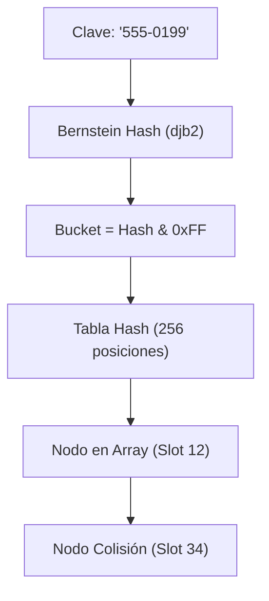

# y_hashmap (Tablas Hash)

`y_hashmap` es una estructura de datos de alto rendimiento dentro de YSI que implementa **tablas hash con resolución de colisiones mediante árboles binarios enlazados** en memoria nativa AMX. Permite indexar arrays estructurados utilizando cadenas de texto (*strings*) o claves alfanuméricas con una complejidad promedio de $\mathcal{O}(1)$ para inserciones y búsquedas.

---

## Introducción y Propósito

En Pawn estándar, los arrays solo pueden indexarse mediante números enteros contiguos:

```pawn
new g_PlayerData[MAX_PLAYERS][E_PLAYER_DATA];
// Acceso válido: g_PlayerData[42][E_PLAYER_SCORE]
// Acceso imposible en Pawn nativo: g_PlayerData["Juan_Perez"][E_PLAYER_SCORE]
```

Para buscar datos asociados a una clave alfanumérica (como el nombre de un jugador, un número de teléfono, el código de un objeto o una matrícula vehicular), la solución tradicional consistía en un bucle lineal $\mathcal{O}(N)$ comparando cadenas con `strcmp`:

```pawn
// Búsqueda lineal ineficiente O(N)
stock BuscarJugadorPorNombre(const nombre[])
{
    foreach (new i : Player)
    {
        new nombreActual[MAX_PLAYER_NAME];
        GetPlayerName(i, nombreActual, sizeof(nombreActual));
        if (!strcmp(nombreActual, nombre, true))
        {
            return i; // Encontrado tras recorrer N jugadores
        }
    }
    return INVALID_PLAYER_ID;
}
```

### La Solución de `y_hashmap`

`y_hashmap` calcula un hash numérico de 32 bits de la clave mediante el algoritmo **Bernstein Hash (djb2)** y lo distribuye en una tabla de dispersión de 256 cubetas (*buckets*). Las colisiones se resuelven mediante nodos binarios embebidos en el propio array sin asignaciones dinámicas en el heap.



### Ventajas Principales
- **Búsqueda $\mathcal{O}(1)$ promedio:** Localización instantánea de registros sin importar el tamaño del dataset.
- **Gestión automática de slots libres:** Soporta lista enlazada de slots no utilizados con `HashMap_GetUnused` y `HashMap_AddUnused`.
- **Cero fugas de memoria (*Zero Leaks*):** Toda la memoria reside en arrays estáticos preasignados en tiempo de compilación.

### Inclusión en el Proyecto

```pawn
#include <YSI_Data\y_hashmap>
```

---

## Tabla de Contenidos

1. [Estructura y Declaración](#estructura-y-declaracion)
2. [Inicialización con `HashMap_Init`](#hashmap_init)
3. [Funciones de Inserción y Búsqueda](#funciones-de-insercion-y-busqueda)
   - [HashMap_Add](#hashmap_add)
   - [HashMap_Get](#hashmap_get)
   - [HashMap_Has](#hashmap_has)
   - [HashMap_Set](#hashmap_set)
4. [Funciones de Eliminación](#funciones-de-eliminacion)
   - [HashMap_RemoveKey](#hashmap_removekey)
   - [HashMap_RemoveValue](#hashmap_removevalue)
5. [Gestión de Slots Libres (Pool Unused)](#gestion-de-slots-libres)
   - [HashMap_GetUnused](#hashmap_getunused)
   - [HashMap_AddUnused](#hashmap_addunused)
6. [Ejemplo Práctico Completo: Agenda Telefónica O(1)](#ejemplo-practico-completo)
7. [Buenas Prácticas y Errores Comunes](#buenas-practicas-y-errores-comunes)

---

## Estructura y Declaración

Para que un array pueda ser gestionado por `y_hashmap`, su estructura `enum` debe incorporar el campo especial `HASH_MAP_DATA` (un bloque de 3 celdas que almacena el hash y los punteros izquierdo y derecho del árbol de colisiones):

```pawn
#define MAX_REGISTROS (200)

enum E_DIRECTORIO
{
    E_DIR_TELEFONO[16],
    E_DIR_NOMBRE_TITULAR[32],
    E_DIR_SALDO,
    // Campo obligatorio reservado para los punteros de y_hashmap:
    E_DIR_HASH_DATA[HASH_MAP_DATA]
}

new g_Directorio[MAX_REGISTROS][E_DIRECTORIO];
new HashMap:g_DirectorioMap<>;
```

---

## Inicialización con `HashMap_Init`

### HashMap_Init

- **Módulo requerido:** `#include <YSI_Data\y_hashmap>`
- **Tipo:** Macro preprocesador / Función stock interna
- **Descripción:** Vincula la tabla hash `HashMap` con el array bidimensional estructurado, configurando la tabla de punteros y encadenando todos los registros como una lista de slots libres no utilizados.

#### Sintaxis
```pawn
HashMap_Init(HashMap:m<>, target[][], enum_slot);
```

#### Parámetros
- `m`: La variable declarada con la etiqueta `HashMap:nombre<>`.
- `target`: El array bidimensional estructurado que contiene los datos.
- `enum_slot`: El campo del enum donde se declaró `[HASH_MAP_DATA]`.

#### Retorno
No devuelve ningún valor.

#### Ejemplo Práctico
```pawn
public OnGameModeInit()
{
    // Inicializar el hashmap vinculado al array g_Directorio
    HashMap_Init(g_DirectorioMap, g_Directorio, E_DIR_HASH_DATA);
    print("[INIT] HashMap de directorio telefónico inicializado.");
    return 1;
}
```

---

## Funciones de Inserción y Búsqueda

### HashMap_Add

- **Módulo requerido:** `#include <YSI_Data\y_hashmap>`
- **Tipo:** Función stock
- **Descripción:** Asocia una clave alfanumérica (`str`) con un índice o slot específico en el array estructurado.

#### Sintaxis
```pawn
bool:HashMap_Add(HashMap:m<>, const str[], value, bool:ignorecase = false);
```

#### Parámetros
- `m`: El hashmap correspondiente.
- `str`: La clave en texto (ej. número de teléfono o nombre).
- `value`: El índice entero del array (slot) que se vinculará a dicha clave.
- `ignorecase` *(opcional)*: Si es `true`, la clave no distingue entre mayúsculas y minúsculas (por defecto `false`).

#### Retorno
Devuelve `true` si el elemento se indexó con éxito, o `false` en caso de fallo.

#### Ejemplo Práctico
```pawn
stock RegistrarNumero(const telefono[], const titular[], saldo)
{
    // Obtener un slot libre disponible en el array
    new slot = HashMap_GetUnused(g_DirectorioMap);
    if (slot == -1)
    {
        print("[ERROR] No hay memoria disponible en el directorio.");
        return -1;
    }

    // Copiar la clave al registro
    format(g_Directorio[slot][E_DIR_TELEFONO], 16, "%s", telefono);
    format(g_Directorio[slot][E_DIR_NOMBRE_TITULAR], 32, "%s", titular);
    g_Directorio[slot][E_DIR_SALDO] = saldo;

    // Indexar en la tabla hash
    HashMap_Add(g_DirectorioMap, telefono, slot);
    return slot;
}
```

---

### HashMap_Get

- **Módulo requerido:** `#include <YSI_Data\y_hashmap>`
- **Tipo:** Función stock
- **Descripción:** Busca la clave indicada en tiempo $\mathcal{O}(1)$ y devuelve el índice del slot del array asociado a ella.

#### Sintaxis
```pawn
HashMap_Get(HashMap:m<>, const str[], bool:ignorecase = false);
```

#### Parámetros
- `m`: El hashmap a consultar.
- `str`: La clave en texto a buscar.
- `ignorecase` *(opcional)*: Si es `true`, ignora mayúsculas/minúsculas.

#### Retorno
Devuelve el número de slot (entero $\ge 0$) donde está almacenado el registro, o `-1` si la clave no existe en el hashmap.

#### Ejemplo Práctico
```pawn
stock ConsultarSaldoPorTelefono(const telefono[])
{
    new slot = HashMap_Get(g_DirectorioMap, telefono);
    if (slot == -1)
    {
        printf("El número %s no está registrado en el sistema.", telefono);
        return -1;
    }

    printf("Titular: %s | Saldo: $%d", g_Directorio[slot][E_DIR_NOMBRE_TITULAR], g_Directorio[slot][E_DIR_SALDO]);
    return g_Directorio[slot][E_DIR_SALDO];
}
```

---

### HashMap_Has

- **Módulo requerido:** `#include <YSI_Data\y_hashmap>`
- **Tipo:** Función stock
- **Descripción:** Verifica en tiempo $\mathcal{O}(1)$ si una clave existe actualmente dentro de la tabla hash.

#### Sintaxis
```pawn
bool:HashMap_Has(HashMap:m<>, const str[], bool:ignorecase = false);
```

#### Parámetros
- `m`: El hashmap a inspeccionar.
- `str`: La clave a comprobar.
- `ignorecase` *(opcional)*: Distinción de mayúsculas/minúsculas.

#### Retorno
Devuelve `true` si la clave está registrada en el hashmap; de lo contrario `false`.

#### Ejemplo Práctico
```pawn
if (HashMap_Has(g_DirectorioMap, "555-1234"))
{
    print("El número ya se encuentra registrado.");
}
```

---

### HashMap_Set

- **Módulo requerido:** `#include <YSI_Data\y_hashmap>`
- **Tipo:** Función stock
- **Descripción:** Actualiza o inserta una clave garantizando unicidad bidireccional: si la clave ya existía, desvincula el registro anterior; si el slot ya tenía otra clave, la elimina antes de reasignarlo.

#### Sintaxis
```pawn
HashMap_Set(HashMap:m<>, const str[], const value);
```

#### Parámetros
- `m`: El hashmap a modificar.
- `str`: La clave alfanumérica.
- `value`: El índice del slot a asignar.

---

## Funciones de Eliminación

### HashMap_RemoveKey

- **Módulo requerido:** `#include <YSI_Data\y_hashmap>`
- **Tipo:** Función stock
- **Descripción:** Elimina una clave de la tabla hash y reconstruye los punteros de árbol binario de la cubeta correspondiente.

#### Sintaxis
```pawn
bool:HashMap_RemoveKey(HashMap:m<>, const str[], bool:ignorecase = false);
```

#### Retorno
Devuelve `true` si la clave existía y fue removida con éxito; `false` si no se encontró.

---

### HashMap_RemoveValue

- **Módulo requerido:** `#include <YSI_Data\y_hashmap>`
- **Tipo:** Función stock
- **Descripción:** Elimina del hashmap el registro vinculado a un slot numérico específico, localizando automáticamente su clave textual asociada.

#### Sintaxis
```pawn
bool:HashMap_RemoveValue(HashMap:m<>, value);
```

#### Retorno
Devuelve `true` si el slot fue desvinculado con éxito.

---

## Gestión de Slots Libres

`y_hashmap` incluye un gestor interno de slots (*free-list pool*) para que no tengas que crear bucles buscando índices vacíos en tu array.

### HashMap_GetUnused

- **Módulo requerido:** `#include <YSI_Data\y_hashmap>`
- **Tipo:** Función stock
- **Descripción:** Obtiene de inmediato el índice del siguiente slot libre disponible en el array en $\mathcal{O}(1)$.

#### Sintaxis
```pawn
HashMap_GetUnused(HashMap:m<>);
```

#### Retorno
Devuelve el índice del slot libre (entero $\ge 0$), o `-1` si todos los slots del array están agotados.

---

### HashMap_AddUnused

- **Módulo requerido:** `#include <YSI_Data\y_hashmap>`
- **Tipo:** Función stock
- **Descripción:** Marca un slot previamente ocupado como libre y disponible para futuras inserciones.

#### Sintaxis
```pawn
HashMap_AddUnused(HashMap:m<>, value);
```

#### Parámetros
- `m`: El hashmap.
- `value`: El índice del slot que ha sido liberado.

---

## Ejemplo Práctico Completo

### Agenda Telefónica O(1) con Asociación de Clientes

```pawn
#include <openmultiplayer>
#include <YSI_Data\y_hashmap>
#include <YSI_Visual\y_commands>

#define MAX_NUMEROS_REGISTRADOS (500)

enum E_TELEFONO_REGISTRO
{
    E_TEL_NUMERO[16],
    E_TEL_NOMBRE[MAX_PLAYER_NAME],
    E_TEL_ACTIVO,
    E_TEL_HASH_DATA[HASH_MAP_DATA]
}

new g_Telefonos[MAX_NUMEROS_REGISTRADOS][E_TELEFONO_REGISTRO];
new HashMap:g_TelefonosMap<>;

public OnGameModeInit()
{
    // 1. Inicializar el HashMap
    HashMap_Init(g_TelefonosMap, g_Telefonos, E_TEL_HASH_DATA);
    print("[SISTEMA] Base de datos de telefonía cargada e indexada en O(1).");
    return 1;
}

// Función para dar de alta un número
stock bool:AltaTelefono(const numero[], const titular[])
{
    if (HashMap_Has(g_TelefonosMap, numero))
    {
        return false; // El número ya existe
    }

    new slot = HashMap_GetUnused(g_TelefonosMap);
    if (slot == -1)
    {
        print("[ERROR] Base de datos de telefonía llena.");
        return false;
    }

    format(g_Telefonos[slot][E_TEL_NUMERO], 16, "%s", numero);
    format(g_Telefonos[slot][E_TEL_NOMBRE], MAX_PLAYER_NAME, "%s", titular);
    g_Telefonos[slot][E_TEL_ACTIVO] = 1;

    // Registrar en el mapa
    HashMap_Add(g_TelefonosMap, numero, slot);
    return true;
}

// Función para dar de baja un número
stock bool:BajaTelefono(const numero[])
{
    new slot = HashMap_Get(g_TelefonosMap, numero);
    if (slot == -1) return false;

    // 1. Retirar del HashMap
    HashMap_RemoveKey(g_TelefonosMap, numero);

    // 2. Limpiar datos del slot
    g_Telefonos[slot][E_TEL_ACTIVO] = 0;
    g_Telefonos[slot][E_TEL_NUMERO][0] = '\0';

    // 3. Devolver el slot a la lista de libres
    HashMap_AddUnused(g_TelefonosMap, slot);
    return true;
}

// Comando para consultar titular en O(1)
YCMD:consultarnumero(playerid, params[], help)
{
    if (isnull(params))
    {
        return SendClientMessage(playerid, 0xFFFFFFFF, "Uso: /consultarnumero [número]");
    }

    new slot = HashMap_Get(g_TelefonosMap, params);
    if (slot == -1)
    {
        return SendClientMessage(playerid, 0xFF0000AA, "El número consultado no existe.");
    }

    new str[128];
    format(str, sizeof(str), "Número: %s | Titular: %s", g_Telefonos[slot][E_TEL_NUMERO], g_Telefonos[slot][E_TEL_NOMBRE]);
    SendClientMessage(playerid, 0x00FF00AA, str);
    return 1;
}
```

---

## Buenas Prácticas y Errores Comunes

### 1. Olvidar `HASH_MAP_DATA` en el Enum
El campo `[HASH_MAP_DATA]` debe estar presente en el enum del array. Si se omite, el código emitirá errores de compilación o fallará al resolver los desplazamientos de memoria en AMX.

### 2. Duplicidad de Claves
`HashMap_Add` espera que cada clave sea única. Si intentas insertar dos registros con la misma clave `"555-0100"`, la búsqueda retornará solo el primero encontrado en el árbol de colisiones. Para reemplazos forzados, utiliza `HashMap_Set`.

### 3. Sincronización al Eliminar
Cuando elimines un registro de tu array, recuerda realizar los dos pasos:
1. `HashMap_RemoveKey(map, clave)` para actualizar el árbol hash.
2. `HashMap_AddUnused(map, slot)` para que ese slot quede disponible para el próximo `HashMap_GetUnused`.
