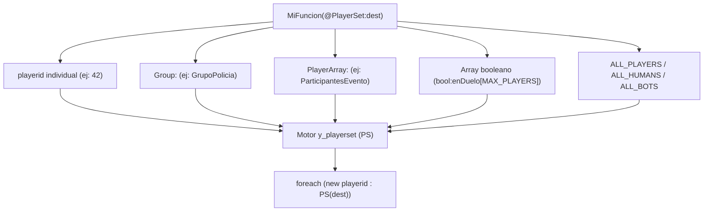

# y_playerarray y y_playerset (Datos y Conjuntos de Jugadores)

El subsistema de datos de jugadores de YSI (`y_playerarray` y `y_playerset`) proporciona estructuras especializadas en el manejo masivo, ultra comprimido y polimórfico de destinatarios y colecciones de jugadores en SA-MP y open.mp.

---

## Introducción y Propósito

En muchos sistemas de juego (notificaciones, guerras de facciones, chat de radio, minijuegos, zonas de captura) es necesario gestionar conjuntos de jugadores:
- Enviar un mensaje a un solo usuario, a los miembros de una banda, a todos los policías o a todo el servidor.
- Mantener una lista de quiénes están dentro de un evento o minijuego.
- Tradicionalmente, esto requería escribir múltiples funciones sobrecargadas o complejas verificaciones manuales.

YSI resuelve esto mediante dos módulos complementarios:
1. **`y_playerarray`:** Un bitarray especializado de tamaño `MAX_PLAYERS` que utiliza solo 1 bit por jugador y se autoidentifica en memoria con una firma interna especial. Se integra con `y_iterate` para recorrer solo jugadores que estén **marcados y a la vez conectados**.
2. **`y_playerset`:** Un sistema de polimorfismo sintáctico (`PSF:` y `@PlayerSet`) que permite escribir **una única función** capaz de recibir indistintamente un `playerid` individual, un grupo (`Group:`), un `PlayerArray`, un array de IDs, un array booleano o macros globales como `ALL_PLAYERS`.



### Inclusión en el Proyecto

```pawn
#include <YSI_Data\y_playerarray>
#include <YSI_Data\y_playerset>
```

---

## Tabla de Contenidos

1. [Módulo 1: `y_playerarray`](#modulo-1-y_playerarray)
   - [Declaración](#declaracion-de-playerarray)
   - [Funciones y Macros de `y_playerarray`](#funciones-y-macros-de-y_playerarray)
   - [Iteración con `foreach (new i : PA(array))`](#iteracion-con-foreach-pa)
2. [Módulo 2: `y_playerset`](#modulo-2-y_playerset)
   - [El Patrón Polimórfico `PSF:`](#el-patron-polimorfico-psf)
   - [El Iterador `PS`](#el-iterador-ps)
   - [Identificadores Globales (`ALL_PLAYERS`, etc.)](#identificadores-globales)
3. [Ejemplo Práctico Completo: Sistema de Anuncios y Notificaciones Multidestinatario](#ejemplo-practico-completo)
4. [Buenas Prácticas y Errores Comunes](#buenas-practicas-y-errores-comunes)

---

## Módulo 1: `y_playerarray`

`y_playerarray` combina la eficiencia de `y_bit` con validación automática de conectividad.

### Declaración de `PlayerArray`

```pawn
// Sintaxis: new PlayerArray:Nombre<MAX_PLAYERS>;
new PlayerArray:g_EnDuelo<MAX_PLAYERS>;
```

#### Anatomía en Memoria
A diferencia de un bitarray ordinario, `PlayerArray` reserva una celda adicional en el índice `0` que almacena el valor mágico `PA_TYPE_PA` (`-4`). Esto permite que otros módulos inspeccionen la cabecera del array y reconozcan inmediatamente que se trata de un conjunto de jugadores válido.

---

### Funciones y Macros de `y_playerarray`

#### PA_Init y PA_FastInit
Inicializan el array marcando su cabecera de tipo.
```pawn
PA_Init(PlayerArray:array<>, bool:init = false); // Limpia o llena todos los bits
PA_FastInit(PlayerArray:array<>);                 // Asigna solo la cabecera mágica (ultra veloz)
```

#### PA_Let
Enciende el bit del jugador indicado (`1` / `true`).
```pawn
PA_Let(PlayerArray:array<>, playerid);
```

#### PA_Vet
Apaga el bit del jugador indicado (`0` / `false`).
```pawn
PA_Vet(PlayerArray:array<>, playerid);
```

#### PA_Get
Obtiene el valor booleano del jugador.
```pawn
bool:PA_Get(PlayerArray:array<>, playerid);
```

#### PA_Set
Asigna un estado booleano explícito.
```pawn
PA_Set(PlayerArray:array<>, playerid, bool:set);
```

#### PA_GetCount
Devuelve el número total de jugadores con bit activo en el conjunto.
```pawn
new total = PA_GetCount(g_EnDuelo);
```

---

### Iteración con `foreach (new i : PA)`

`y_playerarray` provee el iterador especializado `PA()`. Al recorrerlo, **comprueba automáticamente que el jugador esté conectado en el servidor** (`Iter_Contains(Player, i)`):

```pawn
// Solo iterará sobre jugadores que tengan su bit en 1 Y que continúen conectados
foreach (new playerid : PA(g_EnDuelo))
{
    GivePlayerMoney(playerid, 500);
}
```

---

## Módulo 2: `y_playerset`

`y_playerset` permite crear funciones polimórficas donde el parámetro de destinatarios acepta casi cualquier tipo de dato relacionado con jugadores en Pawn.

### El Patrón Polimórfico `PSF:`

Para declarar una función que acepte conjuntos de jugadores universales, se utiliza la macro de interfaz `@PSF()` junto con el prefijo de parámetro `@PlayerSet`:

```pawn
// 1. Declaración de la función usando @PlayerSet:
stock EnviarAlertaGlobal(@PlayerSet:destinatarios, const mensaje[])
{
    // 2. Recorrido usando el iterador PS():
    foreach (new playerid : PS(destinatarios))
    {
        SendClientMessage(playerid, 0xE74C3CAA, mensaje);
    }
}

// 3. Macro envoltorio que activa la magia de sobrecarga sintáctica:
#define EnviarAlertaGlobal( @PSF() EnviarAlertaGlobal(
```

---

### El Iterador `PS`

Dentro de la función, el bucle `foreach (new playerid : PS(destinatarios))` resuelve dinámicamente en tiempo de ejecución:
- Si le pasaste un `playerid` individual (ej: `42`), el bucle se ejecutará exactamente una vez para el ID 42 (si está conectado).
- Si le pasaste un `Group:`, consultará los miembros del grupo (`y_groups`).
- Si le pasaste un `PlayerArray:`, iterará mediante el algoritmo optimizado de bits.
- Si le pasaste un array regular con IDs terminados en `INVALID_PLAYER_ID` (ej: `{1, 4, 9, INVALID_PLAYER_ID}`), recorrerá únicamente esos IDs.
- Si le pasaste un array booleano de tamaño `MAX_PLAYERS` (`bool:enEvento[MAX_PLAYERS]`), iterará sobre los índices cuyo valor sea `true`.

---

### Identificadores Globales

`y_playerset` incluye constantes predefinidas que pueden ser pasadas directamente a cualquier función basada en `@PlayerSet`:

| Identificador | Valor | Acción |
| :--- | :--- | :--- |
| `ALL_PLAYERS` | `0x7FFFFFF1` | Itera sobre todos los jugadores conectados. |
| `ALL_HUMANS` | `0x7FFFFFF1` | Itera sobre todos los jugadores humanos. |
| `ALL_CHARACTERS` | `0x7FFFFFF2` | Itera sobre humanos y bots combinados. |
| `ALL_BOTS` | `0x7FFFFFF3` | Itera únicamente sobre NPCs / bots. |

---

## Ejemplo Práctico Completo

### Sistema de Notificaciones Universal Multidestinatario

```pawn
#include <openmultiplayer>
#include <YSI_Data\y_playerarray>
#include <YSI_Data\y_playerset>
#include <YSI_Visual\y_commands>

// Conjunto para jugadores en una zona de paintball
new PlayerArray:g_EnPaintball<MAX_PLAYERS>;

// 1. Declaramos la función universal con @PlayerSet
stock Notificar(@PlayerSet:destinatarios, color, const texto[])
{
    foreach (new pid : PS(destinatarios))
    {
        SendClientMessage(pid, color, texto);
    }
}

// 2. Definimos la macro envoltorio con @PSF()
#define Notificar( @PSF() Notificar(

public OnGameModeInit()
{
    PA_FastInit(g_EnPaintball);
    return 1;
}

// Comandos demostrando el polimorfismo de la misma función:

// Caso A: Enviar a un único jugador individual
YCMD:avisopersonal(playerid, params[], help)
{
    Notificar(playerid, 0x00FF00AA, "Este es un aviso que solo ves tú.");
    return 1;
}

// Caso B: Enviar a todo el servidor con ALL_PLAYERS
YCMD:anunciototal(playerid, params[], help)
{
    Notificar(ALL_PLAYERS, 0xFFFF00AA, "¡Atención a todos los jugadores del servidor!");
    return 1;
}

// Caso C: Enviar al conjunto PlayerArray
YCMD:avisopaintball(playerid, params[], help)
{
    Notificar(g_EnPaintball, 0x33CCFFAA, "[PAINTBALL] La ronda comenzará en 30 segundos.");
    return 1;
}

// Caso D: Enviar a una lista fija de IDs
YCMD:avisoduo(playerid, params[], help)
{
    new pareja[3];
    pareja[0] = playerid;
    pareja[1] = 5; // ID del compañero
    pareja[2] = INVALID_PLAYER_ID; // Centinela de fin obligatorio en listas fijas

    Notificar(pareja, 0xFF9900AA, "Mensaje conjunto para ti y tu compañero.");
    return 1;
}
```

---

## Buenas Prácticas y Errores Comunes

### 1. Inicialización Obligatoria con `PA_FastInit`
Antes de utilizar un `PlayerArray`, invoca `PA_FastInit(array)`. Esto asegura que la primera celda contenga la firma `PA_TYPE_PA`, permitiendo que `y_playerset` lo distinga de un array booleano normal.

### 2. Centinela `INVALID_PLAYER_ID` en Listas Fijas
Si pasas un array con IDs específicos de jugadores (ej. `new list[] = {0, 1, 2}`), debes finalizarlo siempre con `INVALID_PLAYER_ID` (`{0, 1, 2, INVALID_PLAYER_ID}`). De lo contrario, `y_playerset` intentará leer posiciones de memoria posteriores sin control.

### 3. Pila de Anidación `MAX_PLAYER_SET_STACK`
`y_playerset` permite llamadas anidadas (por ejemplo, invocar una función `@PlayerSet` dentro del bucle de otra función `@PlayerSet`) hasta un límite predeterminado de 3 niveles (`MAX_PLAYER_SET_STACK`). Si tu script excede esa profundidad, puedes redefinirlo antes de incluir la librería:
```pawn
#define MAX_PLAYER_SET_STACK (6)
#include <YSI_Data\y_playerset>
```
