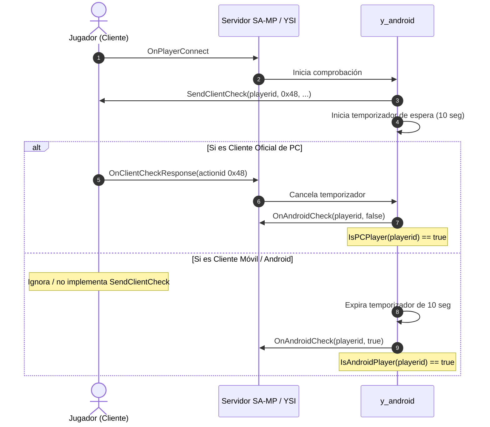

# y_android (Detección de Clientes Móviles)

El módulo `y_android` provee una capa de detección automatizada e introspección de clientes para distinguir entre jugadores que se conectan desde un ordenador de escritorio (PC) y aquellos que acceden mediante aplicaciones no oficiales de SA-MP para dispositivos móviles (Android / iOS).

A medida que la base de jugadores móviles ha crecido en la comunidad de SA-MP y open.mp, se ha vuelto crítico adaptar elementos de la interfaz de usuario (TextDraws), controles táctiles, ayudas de apuntado (*aim assist*) o incluso restringir ciertas zonas o modos de juego competitivos exclusivamente para PC.

---

## Ventajas sobre los Métodos Tradicionales

1. **Detección No Intrusiva por Memoria (`SendClientCheck`):** No requiere solicitar que el usuario ingrese comandos ni inspeccionar versiones falsificables de cadenas de texto. Aprovecha el mecanismo nativo de SA-MP para solicitar un check de memoria cliente (`actionid 0x48`).
2. **Callbacks y Funciones Limpias:** Dispone del callback de evento `OnAndroidCheck` y las funciones booleanas `IsAndroidPlayer` e `IsPCPlayer`.
3. **Manejo Automático de Temporizadores:** Si el cliente es una app móvil que no responde a la llamada de comprobación nativa, el sistema resuelve el estado mediante un temporizador asíncrono sin bloquear el hilo principal del servidor.
4. **Desactivable por Preprocesador:** Puede deshabilitarse de forma global si el servidor no requiere comprobaciones mediante `#define YSI_NO_ANDROID_CHECK`.

---

## Cómo Funciona la Detección



---

## Inclusión en el Script

Para incluir `y_android`:

```pawn
#include <openmultiplayer> // o <a_samp>
#include <YSI_Players\y_android>
```

> [!TIP]
> Si deseas compilar sin comprobación de Android para ahorrar temporizadores en servidores donde no admites clientes móviles o en entornos de prueba cerrados:
> ```pawn
> #define YSI_NO_ANDROID_CHECK
> #include <YSI_Players\y_android>
> ```

## Tabla de Contenido

- [Funciones del Módulo](#funciones-del-modulo)
  - [IsAndroidPlayer](#isandroidplayer)
  - [IsPCPlayer](#ispcplayer)
- [Callbacks Hookeables](#callbacks-hookeables)
  - [OnAndroidCheck](#onandroidcheck)
- [Ajustes de Interfaz y Compatibilidad Móvil](#ajustes-de-interfaz-y-compatibilidad-movil)
  - [TextDraws y Proporciones Panorámicas](#textdraws-y-proporciones-panoramicas)
  - [Diálogos y Teclado en Pantalla](#dialogos-y-teclado-en-pantalla)
  - [Ayuda de Apuntado (Aim Assist) y Balance de Armas](#ayuda-de-apuntado-aim-assist-y-balance-de-armas)
- [Ejemplo Práctico Completo: Adaptación de HUD y Notificaciones](#ejemplo-practico-completo-adaptacion-de-hud-y-notificaciones)
- [Buenas Prácticas y Errores Comunes](#buenas-practicas-y-errores-comunes)

---

## Funciones del Módulo

### IsAndroidPlayer

- **Módulo:** `#include <YSI_Players\y_android>`
- **Tipo:** `Función stock`
- **Descripción:** Determina si el jugador indicado está conectado desde un cliente móvil Android.
- **Sintaxis:**
```pawn
bool:IsAndroidPlayer(playerid)
```
- **Parámetros:**
  - `playerid`: ID del jugador conectado.
- **Retorno:** Devuelve `true` si el jugador ha sido verificado como usuario de Android; `false` si es PC o si el chequeo aún está en curso.
- **Ejemplo:**
```pawn
if (IsAndroidPlayer(playerid))
{
    SendClientMessage(playerid, 0x00FF00FF, "Detectamos que juegas desde un dispositivo Android.");
}
```

---

### IsPCPlayer

- **Módulo:** `#include <YSI_Players\y_android>`
- **Tipo:** `Función stock`
- **Descripción:** Determina si el jugador está conectado desde un cliente oficial de ordenador (PC).
- **Sintaxis:**
```pawn
bool:IsPCPlayer(playerid)
```
- **Parámetros:**
  - `playerid`: ID del jugador conectado.
- **Retorno:** Devuelve `true` si el cliente respondió correctamente al chequeo de memoria como PC oficial; `false` si es Android o aún no responde.
- **Ejemplo:**
```pawn
if (IsPCPlayer(playerid))
{
    // Mostrar instrucciones con teclas de teclado físico
    SendClientMessage(playerid, -1, "Presiona la tecla {FFFF00}'Y'{FFFFFF} para abrir el inventario.");
}
else
{
    // Instrucciones para pantalla táctil
    SendClientMessage(playerid, -1, "Usa el comando {FFFF00}/inventario{FFFFFF} para ver tus objetos.");
}
```

---

## Callbacks Hookeables

### OnAndroidCheck

- **Módulo:** `#include <YSI_Players\y_android>`
- **Tipo:** `Callback hookeable`
- **Descripción:** Se ejecuta de forma asíncrona unos segundos después de la conexión del jugador, una vez que el sistema confirma de manera concluyente si el cliente es móvil o PC.
- **Sintaxis:**
```pawn
forward OnAndroidCheck(playerid, bool:isDisgustingThiefToBeBanned);
public OnAndroidCheck(playerid, bool:isDisgustingThiefToBeBanned)
{
    // isDisgustingThiefToBeBanned == true si es Android
    // isDisgustingThiefToBeBanned == false si es PC
    return 1;
}
```
- **Parámetros:**
  - `playerid`: ID del jugador evaluado.
  - `bool:isDisgustingThiefToBeBanned`: Booleano que indica el resultado de la detección (`true` = cliente móvil Android; `false` = PC). *Nota: El nombre del parámetro refleja el humor satírico histórico de Y_Less respecto a los clientes móviles no autorizados en su momento.*
- **Ejemplo:**
```pawn
#include <YSI_Coding\y_hooks>

hook OnAndroidCheck(playerid, bool:isAndroid)
{
    if (isAndroid)
    {
        printf("[DISPOSITIVO] El jugador %d se ha conectado desde Android.", playerid);
        // Ajustar TextDraws adaptados para móviles
    }
    else
    {
        printf("[DISPOSITIVO] El jugador %d se ha conectado desde PC.", playerid);
    }
    return 1;
}
```

---

## Ajustes de Interfaz y Compatibilidad Móvil

### TextDraws y Proporciones Panorámicas
Los clientes de Android comúnmente ejecutan pantallas con relaciones de aspecto ultra panorámicas (18:9, 19.5:9, 20:9).
- **Bordes de pantalla:** Los TextDraws posicionados cerca de las coordenadas extremas horizontales (X > 600 o X < 20) pueden quedar cortados o quedar debajo de los recortes de cámara (*notch* o cámaras frontales integradas).
- **TextDraws Clickeables:** En Android, hacer clic con el dedo sobre un TextDraw es menos preciso que con un ratón. Se recomienda aumentar el tamaño de la caja clickeable (`TextDrawTextSize` / `PlayerTextDrawTextSize`) para usuarios de Android.

### Diálogos y Teclado en Pantalla
- Al abrirse un cuadro de diálogo con estilo `DIALOG_STYLE_INPUT` o `DIALOG_STYLE_PASSWORD`, el teclado virtual de Android se despliega y cubre más del 50% inferior de la pantalla. Evita mostrar TextDraws cruciales en la mitad inferior durante la autenticación.

### Ayuda de Apuntado (Aim Assist) y Balance de Armas
- La mayoría de APKs de SA-MP para Android incluyen soporte de apuntado asistido automático al estilo de consolas. En servidores con combates competitivos o PvP, es una práctica común crear salas de disparo separadas o ajustar el daño según el resultado de `IsAndroidPlayer(playerid)`.

---

## Ejemplo Práctico Completo: Adaptación de HUD y Notificaciones

El siguiente ejemplo detecta al cliente mediante `OnAndroidCheck`, ajusta la interfaz gráfica y configura notificaciones apropiadas según el dispositivo:

```pawn
#include <openmultiplayer>
#include <YSI_Players\y_android>
#include <YSI_Coding\y_hooks>
#include <YSI_Visual\y_commands>

// TextDraws por jugador adaptados a la plataforma
new PlayerText:g_TextDrawHUD[MAX_PLAYERS];

hook OnPlayerConnect(playerid)
{
    // Crear TextDraw básico con posición estándar
    g_TextDrawHUD[playerid] = CreatePlayerTextDraw(playerid, 550.0, 10.0, "Servidor Roleplay");
    PlayerTextDrawLetterSize(playerid, g_TextDrawHUD[playerid], 0.35, 1.2);
    PlayerTextDrawColor(playerid, g_TextDrawHUD[playerid], 0xFFFFFFFF);
    return 1;
}

hook OnPlayerDisconnect(playerid, reason)
{
    if (g_TextDrawHUD[playerid] != PlayerText:INVALID_TEXT_DRAW)
    {
        PlayerTextDrawDestroy(playerid, g_TextDrawHUD[playerid]);
        g_TextDrawHUD[playerid] = PlayerText:INVALID_TEXT_DRAW;
    }
    return 1;
}

// Callback de detección ejecutado automáticamente por y_android
hook OnAndroidCheck(playerid, bool:isAndroid)
{
    if (isAndroid)
    {
        // El cliente es móvil: adaptamos la posición para evitar el notch o bordes
        SendClientMessage(playerid, 0x00FF00FF, "[CLIENTE] ¡Bienvenido desde SA-MP Mobile!");
        SendClientMessage(playerid, -1, "Tip: Usa {FFFF00}/ayudamovil{FFFFFF} para conocer los controles tactiles.");

        // Reubicar el TextDraw más hacia el centro seguro de la pantalla
        PlayerTextDrawDestroy(playerid, g_TextDrawHUD[playerid]);
        g_TextDrawHUD[playerid] = CreatePlayerTextDraw(playerid, 450.0, 15.0, "Servidor Roleplay (Movil)");
        PlayerTextDrawLetterSize(playerid, g_TextDrawHUD[playerid], 0.40, 1.4); // Letras más grandes para pantallas táctiles
        PlayerTextDrawShow(playerid, g_TextDrawHUD[playerid]);
    }
    else
    {
        // El cliente es PC
        SendClientMessage(playerid, 0x00FFFFFF, "[CLIENTE] Conectado desde PC. ¡Disfruta de la mejor experiencia grafica!");
        PlayerTextDrawShow(playerid, g_TextDrawHUD[playerid]);
    }
    return 1;
}

YCMD:ayudamovil(playerid, params[], help)
{
    if (!IsAndroidPlayer(playerid))
    {
        return SendClientMessage(playerid, 0xFF0000FF, "Este comando solo esta disponible para jugadores en dispositivos moviles.");
    }

    SendClientMessage(playerid, -1, "--- GUIA DE CONTROLES TACTILES ---");
    SendClientMessage(playerid, -1, "• Doble toque en correr para esprintar.");
    SendClientMessage(playerid, -1, "• Toca el radar para expandir el mapa.");
    SendClientMessage(playerid, -1, "• Boton G en pantalla para entrar como pasajero.");
    return 1;
}
```

---

## Buenas Prácticas y Errores Comunes

### Buenas Prácticas
1. **Esperar a `OnAndroidCheck`:** No llames a `IsAndroidPlayer` inmediatamente en `OnPlayerConnect` esperando un resultado definitivo, ya que el handshake de memoria tarda entre 1 y 10 segundos en resolverse. Realiza tus adaptaciones dentro del hook `OnAndroidCheck`.
2. **Respaldo Amigable:** Nunca asumas que todos los jugadores en Android son tramposos. Muchos usuarios juegan limpiamente desde teléfonos. Bríndales una interfaz legible adaptada con letras ligeramente más grandes.
3. **Optimizar Diálogos:** Utiliza listas simples (`DIALOG_STYLE_LIST`) o mensajes informativos (`DIALOG_STYLE_MSGBOX`) en lugar de interfaces complejas con múltiples inputs si la mayoría de tu público usa teléfonos móviles.

### Errores Comunes
- **Consultar el Estado Prematuramente:** Evaluar `IsAndroidPlayer(playerid)` en `OnPlayerRequestClass` devolverá `false` porque la respuesta de red aún no ha llegado desde el cliente.
- **Sobrescribir `OnClientCheckResponse` sin Hooking:** Si implementas `OnClientCheckResponse` en tu gamemode sin usar `hook` o sin llamar al ALS anterior, romperás la lógica interna de `y_android`.
