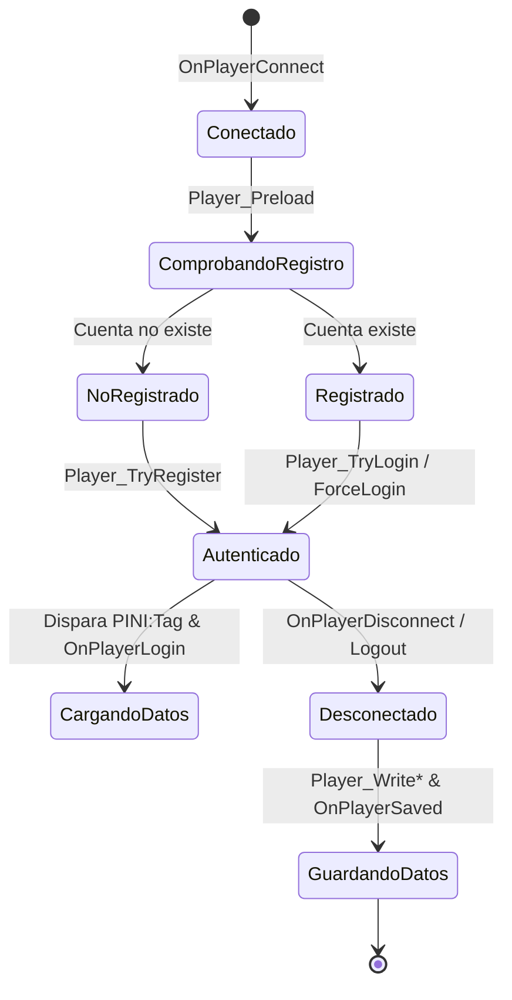

# y_users

`y_users` es el sistema nativo de gestión de cuentas, autenticación y persistencia de usuarios de la suite YSI. Proporciona una arquitectura completa y optimizada para registrar usuarios, verificar contraseñas con hashing criptográfico, gestionar identificadores únicos de cuenta (`uid`), asociar alias y almacenar datos del jugador de forma modular.

A diferencia de los sistemas tradicionales donde todo el guardado de datos está centralizado en un único archivo gigante con miles de líneas, `y_users` permite que cada filterscript, include o subsistema registre y cargue sus propios datos del jugador mediante la macro `PINI:` sin interferir con otros scripts.

---

## Ventajas sobre los Métodos Tradicionales

1. **Persistencia Descentralizada y Modular:** Diferentes módulos pueden guardar sus propios datos en el archivo del usuario mediante etiquetas (`tags` de INI o tablas de BD). Un sistema de vehículos puede guardar su propia sección sin tocar la lógica del gamemode principal.
2. **Identificador Único Universal (`uid`):** Cada usuario registrado obtiene un ID persistente secuencial (`uid`), independiente de su nombre o slot de conexión (`playerid`).
3. **Soporte de Agrupación de Cuentas (Account Grouping):** Un jugador puede enlazar múltiples cuentas secundarias a una misma cuenta principal mediante `Player_TryGroup`, compartiendo estadísticas y privilegios sin duplicar datos.
4. **Seguridad y Criptografía Integrada:** Soporta algoritmos de hashing como Whirlpool (`PP_WHIRLPOOL`) y MD5 (`PP_MD5`) para evitar contraseñas en texto plano.
5. **Backends Flexibles:** Compatible de forma transparente con almacenamiento en archivos INI planos (`scriptfiles/YSI/users/`) o bases de datos relacionales (`USERS_USE_MYSQL` o `USERS_USE_SQLITE`).

---

## Configuración e Inclusión Obligatoria

Para utilizar `y_users`, es **estrictamente obligatorio** definir la constante `MODE_NAME` y el método de hashing antes de incluir el archivo:

```pawn
#include <openmultiplayer> // o <a_samp>

// 1. Configuración del método de hashing (Recomendado: Whirlpool o MD5)
#define PP_WHIRLPOOL // Requiere el plugin Whirlpool
// O alternativamente: #define PP_MD5

// 2. Nombre del modo para el espacio de nombres de los datos (Obligatorio)
#define MODE_NAME "MiServidor"

// 3. Inclusión del módulo
#include <YSI_Players\y_users>
```

> [!IMPORTANT]
> Si no defines `MODE_NAME` antes de incluir `y_users`, el compilador emitirá un error fatal: `Please define "MODE_NAME" before including y_users.`

---

## Tabla de Contenido

- [Ciclo de Vida de una Cuenta](#ciclo-de-vida-de-una-cuenta)
- [Funciones de Autenticación](#funciones-de-autenticacion)
  - [Player_TryRegister](#player_tryregister)
  - [Player_TryLogin](#player_trylogin)
  - [Player_ForceLogin](#player_forcelogin)
  - [Player_ChangePassword](#player_changepassword)
  - [Player_TryGroup y Player_ForceGroup](#player_trygroup-y-player_forcegroup)
- [Funciones de Escritura y Guardado](#funciones-de-escritura-y-guardado)
  - [Player_WriteInt](#player_writeint)
  - [Player_WriteString](#player_writestring)
  - [Player_WriteFloat](#player_writefloat)
  - [Player_WriteBool](#player_writebool)
  - [Player_RemoveEntry](#player_removeentry)
- [Carga Modular de Datos: Macro PINI](#carga-modular-de-datos-macro-pini)
- [Callbacks del Sistema de Cuentas](#callbacks-del-sistema-de-cuentas)
  - [OnPlayerLogin](#onplayerlogin)
  - [OnPlayerLogout](#onplayerlogout)
  - [OnPlayerSaved](#onplayersaved)
- [Ejemplo Práctico Completo: Sistema de Registro, Login y Guardado](#ejemplo-practico-completo-sistema-de-registro-login-y-guardado)
- [Buenas Prácticas y Errores Comunes](#buenas-practicas-y-errores-comunes)

---

## Ciclo de Vida de una Cuenta



---

## Funciones de Autenticación

### Player_TryRegister

- **Módulo:** `#include <YSI_Players\y_users>`
- **Tipo:** `Función stock / foreign`
- **Descripción:** Registra una cuenta nueva para el jugador conectado utilizando la contraseña indicada. Si el nombre ya está registrado, intentará autenticarlo con la contraseña proporcionada.
- **Sintaxis:**
```pawn
Player_TryRegister(playerid, string:password[])
```
- **Parámetros:**
  - `playerid`: ID del jugador conectado.
  - `string:password[]`: Contraseña en texto plano suministrada por el usuario (será hasheada automáticamente antes de guardarse).
- **Retorno:** Devuelve el identificador único `uid` (> 0) en caso de éxito, o un valor negativo/cero en caso de error o contraseña inválida.
- **Ejemplo:**
```pawn
YCMD:register(playerid, params[], help)
{
    if (isnull(params))
    {
        return SendClientMessage(playerid, -1, "{FFFF00}Uso:{FFFFFF} /register [clave]");
    }
    
    if (strlen(params) < 4)
    {
        return SendClientMessage(playerid, 0xFF0000FF, "La clave debe tener al menos 4 caracteres.");
    }

    new uid = Player_TryRegister(playerid, params);
    if (uid > 0)
    {
        SendClientMessage(playerid, 0x00FF00FF, "¡Cuenta registrada y sesion iniciada con exito!");
    }
    else
    {
        SendClientMessage(playerid, 0xFF0000FF, "Error al registrar la cuenta. Es posible que el nombre ya este en uso.");
    }
    return 1;
}
```

---

### Player_TryLogin

- **Módulo:** `#include <YSI_Players\y_users>`
- **Tipo:** `Función stock / foreign`
- **Descripción:** Intenta autenticar a un jugador comparando el hash de la contraseña suministrada con la contraseña guardada en el backend.
- **Sintaxis:**
```pawn
Player_TryLogin(playerid, string:password[])
```
- **Parámetros:**
  - `playerid`: ID del jugador.
  - `string:password[]`: Contraseña introducida por el usuario.
- **Retorno:** Devuelve el `uid` (> 0) si la contraseña es correcta, lo que a su vez activa `OnPlayerLogin` y los callbacks `PINI:`; devuelve 0 o negativo si la contraseña es incorrecta.
- **Ejemplo:**
```pawn
YCMD:login(playerid, params[], help)
{
    if (isnull(params))
    {
        return SendClientMessage(playerid, -1, "{FFFF00}Uso:{FFFFFF} /login [clave]");
    }

    if (Player_TryLogin(playerid, params) > 0)
    {
        SendClientMessage(playerid, 0x00FF00FF, "Has iniciado sesion correctamente.");
    }
    else
    {
        SendClientMessage(playerid, 0xFF0000FF, "Contraseña incorrecta. Intentalo de nuevo.");
    }
    return 1;
}
```

---

### Player_ForceLogin

- **Módulo:** `#include <YSI_Players\y_users>`
- **Tipo:** `Función stock / foreign`
- **Descripción:** Fuerza el inicio de sesión del jugador sin requerir la verificación de su contraseña. Resulta ideal para sistemas de autologin por dirección IP, token de Discord o autenticaciones administrativas.
- **Sintaxis:**
```pawn
Player_ForceLogin(playerid)
```
- **Parámetros:**
  - `playerid`: ID del jugador.
- **Retorno:** Devuelve el `uid` asignado al jugador.
- **Ejemplo:**
```pawn
// Autologin si coincide la IP guardada previamente:
if (EsMismaIP(playerid))
{
    Player_ForceLogin(playerid);
    SendClientMessage(playerid, 0x00FF00FF, "Sesion restaurada automaticamente por IP.");
}
```

---

### Player_ChangePassword

- **Módulo:** `#include <YSI_Players\y_users>`
- **Tipo:** `Función stock / foreign`
- **Descripción:** Actualiza la contraseña de la cuenta del jugador en el backend, recalculando su hash criptográfico.
- **Sintaxis:**
```pawn
Player_ChangePassword(playerid, string:password[])
```
- **Parámetros:**
  - `playerid`: ID del jugador autenticado.
  - `string:password[]`: Nueva contraseña en texto plano.
- **Ejemplo:**
```pawn
YCMD:cambiarclave(playerid, params[], help)
{
    if (strlen(params) < 5)
    {
        return SendClientMessage(playerid, -1, "La nueva clave debe tener al menos 5 caracteres.");
    }

    Player_ChangePassword(playerid, params);
    SendClientMessage(playerid, 0x00FF00FF, "Tu clave ha sido cambiada satisfactoriamente.");
    return 1;
}
```

---

### Player_TryGroup y Player_ForceGroup

- **Módulo:** `#include <YSI_Players\y_users>`
- **Tipo:** `Función stock / foreign`
- **Descripción:** Vincula la cuenta del jugador con otra cuenta existente (`other[]`), permitiendo que ambas compartan la misma información, estadísticas y `uid`.
- **Sintaxis:**
```pawn
Player_TryGroup(playerid, string:other[], string:password[])
Player_ForceGroup(playerid, string:other[])
```
- **Ejemplo:**
```pawn
// El jugador vincula su personaje secundario con su cuenta principal:
Player_TryGroup(playerid, "Juan_Perez", "ClaveDeJuan");
```

---

## Funciones de Escritura y Guardado

Cuando el jugador se desconecta o cuando se llama a un guardado manual, se utilizan las siguientes funciones para escribir valores en el almacenamiento del usuario.

### Player_WriteInt

- **Módulo:** `#include <YSI_Players\y_users>`
- **Tipo:** `Función stock`
- **Descripción:** Guarda un valor entero en el archivo del usuario bajo la etiqueta configurada por `MODE_NAME`.
- **Sintaxis:**
```pawn
Player_WriteInt(const name[], data)
```
- **Parámetros:**
  - `const name[]`: Clave o nombre de la propiedad (ej: `"Dinero"`, `"Nivel"`).
  - `data`: Valor entero a guardar.
- **Ejemplo:**
```pawn
Player_WriteInt("Dinero", GetPlayerMoney(playerid));
Player_WriteInt("Score", GetPlayerScore(playerid));
```

---

### Player_WriteString

- **Módulo:** `#include <YSI_Players\y_users>`
- **Tipo:** `Función stock`
- **Descripción:** Guarda una cadena de texto en el registro del usuario.
- **Sintaxis:**
```pawn
Player_WriteString(const name[], const data[])
```
- **Ejemplo:**
```pawn
Player_WriteString("UltimaIP", "192.168.1.50");
```

---

### Player_WriteFloat

- **Módulo:** `#include <YSI_Players\y_users>`
- **Tipo:** `Función stock`
- **Descripción:** Guarda un número de coma flotante con una precisión configurable.
- **Sintaxis:**
```pawn
Player_WriteFloat(const name[], Float:data, accuracy = 4)
```
- **Ejemplo:**
```pawn
new Float:x, Float:y, Float:z;
GetPlayerPos(playerid, x, y, z);
Player_WriteFloat("PosX", x);
Player_WriteFloat("PosY", y);
Player_WriteFloat("PosZ", z);
```

---

### Player_WriteBool

- **Módulo:** `#include <YSI_Players\y_users>`
- **Tipo:** `Función stock`
- **Descripción:** Guarda un valor booleano (`true`/`false`).
- **Sintaxis:**
```pawn
Player_WriteBool(const name[], bool:data)
```
- **Ejemplo:**
```pawn
Player_WriteBool("TieneLicencia", true);
```

---

### Player_RemoveEntry

- **Módulo:** `#include <YSI_Players\y_users>`
- **Tipo:** `Función stock`
- **Descripción:** Elimina una clave previamente guardada en el archivo del usuario.
- **Sintaxis:**
```pawn
Player_RemoveEntry(const name[])
```

---

## Carga Modular de Datos: Macro PINI

La macro `PINI:` es la contraparte de `y_ini` especializada para `y_users`. Permite declarar bloques de lectura específicos para cargar datos automáticamente cuando un usuario inicia sesión.

### Sintaxis de PINI

```pawn
PINI:NombreTag(playerid, name[], value[])
{
    INI_Int("ClaveEntero", g_VariableEntera[playerid]);
    INI_Float("ClaveFloat", g_VariableFloat[playerid]);
    INI_String("ClaveString", g_VariableCadena[playerid]);
    INI_Bool("ClaveBool", g_VariableBool[playerid]);
    return 1;
}
```

> [!NOTE]
> Por defecto, el nombre del tag es el especificado en `#define MODE_NAME`. Puedes definir múltiples secciones usando nombres adicionales si trabajas en módulos separados.

---

## Callbacks del Sistema de Cuentas

### OnPlayerLogin

- **Módulo:** `#include <YSI_Players\y_users>`
- **Tipo:** `Callback hookeable`
- **Descripción:** Se ejecuta inmediatamente después de que un jugador se autentica exitosamente (mediante `Player_TryLogin`, `Player_TryRegister` o `Player_ForceLogin`). Es el momento idóneo para sincronizar estadísticas, aplicar skins y posicionar al jugador.
- **Sintaxis:**
```pawn
forward OnPlayerLogin(playerid, uid);
public OnPlayerLogin(playerid, uid)
{
    // Código de inicialización del jugador tras loguearse
    return 1;
}
```

---

### OnPlayerLogout

- **Módulo:** `#include <YSI_Players\y_users>`
- **Tipo:** `Callback hookeable`
- **Descripción:** Se llama cuando un usuario cierra sesión o se desconecta del servidor antes de destruir su sesión en memoria.
- **Sintaxis:**
```pawn
forward OnPlayerLogout(playerid, uid);
public OnPlayerLogout(playerid, uid)
{
    // Código de guardado de variables
    return 1;
}
```

---

### OnPlayerSaved

- **Módulo:** `#include <YSI_Players\y_users>`
- **Tipo:** `Callback hookeable`
- **Descripción:** Se ejecuta una vez que los datos del usuario han sido volcados y confirmados en el backend físico de almacenamiento (archivo INI o Base de Datos).
- **Sintaxis:**
```pawn
forward OnPlayerSaved(playerid, uid);
public OnPlayerSaved(playerid, uid)
{
    printf("[YSI] Datos guardados exitosamente para el UID %d.", uid);
    return 1;
}
```

---

## Ejemplo Práctico Completo: Sistema de Registro, Login y Guardado

```pawn
#include <openmultiplayer>

// Configuración obligatoria previa a y_users
#define PP_WHIRLPOOL
#define MODE_NAME "RoleplayV"

#include <YSI_Players\y_users>
#include <YSI_Visual\y_commands>
#include <YSI_Coding\y_hooks>

// Estructura de datos del jugador
enum E_DATOS_JUGADOR
{
    pAsesinatos,
    pMuertes,
    pDinero,
    pAdminLevel
}

new g_UserData[MAX_PLAYERS][E_DATOS_JUGADOR];

// Carga automática de datos mediante PINI
PINI:RoleplayV(playerid, name[], value[])
{
    INI_Int("Asesinatos", g_UserData[playerid][pAsesinatos]);
    INI_Int("Muertes", g_UserData[playerid][pMuertes]);
    INI_Int("Dinero", g_UserData[playerid][pDinero]);
    INI_Int("AdminLevel", g_UserData[playerid][pAdminLevel]);
    return 1;
}

// Callback de inicio de sesión
hook OnPlayerLogin(playerid, uid)
{
    // Aplicar las estadísticas cargadas
    ResetPlayerMoney(playerid);
    GivePlayerMoney(playerid, g_UserData[playerid][pDinero]);
    SetPlayerScore(playerid, g_UserData[playerid][pAsesinatos]);

    new msg[128];
    format(msg, sizeof(msg), "{00FF00}[BIENVENIDO]{FFFFFF} Has iniciado sesion. UID de cuenta: #%d | Nivel Staff: %d", uid, g_UserData[playerid][pAdminLevel]);
    SendClientMessage(playerid, -1, msg);
    return 1;
}

// Callback de guardado al desconectar
hook OnPlayerLogout(playerid, uid)
{
    // Guardar las variables del jugador en el backend
    Player_WriteInt("Asesinatos", g_UserData[playerid][pAsesinatos]);
    Player_WriteInt("Muertes", g_UserData[playerid][pMuertes]);
    Player_WriteInt("Dinero", GetPlayerMoney(playerid));
    Player_WriteInt("AdminLevel", g_UserData[playerid][pAdminLevel]);
    return 1;
}

// Limpieza de datos en desconexión
hook OnPlayerDisconnect(playerid, reason)
{
    g_UserData[playerid][pAsesinatos] = 0;
    g_UserData[playerid][pMuertes] = 0;
    g_UserData[playerid][pDinero] = 0;
    g_UserData[playerid][pAdminLevel] = 0;
    return 1;
}

// Comandos de prueba de sesión
YCMD:registro(playerid, params[], help)
{
    if (isnull(params))
    {
        return SendClientMessage(playerid, -1, "{FFFF00}Uso:{FFFFFF} /registro [contraseña]");
    }

    new uid = Player_TryRegister(playerid, params);
    if (uid > 0)
    {
        SendClientMessage(playerid, 0x00FF00FF, "Registro completado exitosamente.");
    }
    else
    {
        SendClientMessage(playerid, 0xFF0000FF, "Error al registrar la cuenta.");
    }
    return 1;
}

YCMD:ingresar(playerid, params[], help)
{
    if (isnull(params))
    {
        return SendClientMessage(playerid, -1, "{FFFF00}Uso:{FFFFFF} /ingresar [contraseña]");
    }

    if (Player_TryLogin(playerid, params) <= 0)
    {
        SendClientMessage(playerid, 0xFF0000FF, "Contraseña incorrecta.");
    }
    return 1;
}
```

---

## Buenas Prácticas y Errores Comunes

### Buenas Prácticas
1. **Mantener `MODE_NAME` Consistente:** Debe ser el mismo en todos los filterscripts y módulos que accedan al archivo del usuario. Si un script usa `MODE_NAME "ModoA"` y otro usa `MODE_NAME "ModoB"`, cada uno leerá secciones distintas del archivo.
2. **Utilizar Algoritmos Fuertes:** Siempre define `PP_WHIRLPOOL`. Evita usar hashes antiguos o inseguros como MD5 si vas a alojar servidores en producción.
3. **Reseteo de Variables Locales:** Asegúrate de vaciar las variables del array en `OnPlayerDisconnect` para evitar que un nuevo jugador que ocupe el mismo `playerid` herede temporalmente datos del anterior.

### Errores Comunes
- **Omitir `MODE_NAME`:** Causa error de preprocesador en tiempo de compilación.
- **Escribir Datos Fuera de Sesión:** Llamar a `Player_Write*` cuando el jugador no ha iniciado sesión válida provocará que no haya ningún archivo de destino abierto.
- **Falta del Plugin de Hashing:** Si defines `PP_WHIRLPOOL` sin tener cargado el plugin `whirlpool.so` / `whirlpool.dll` en `server.cfg`, el servidor fallará al calcular las firmas de contraseñas.
