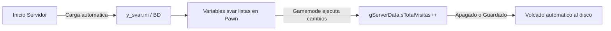

# y_svar & y_uvar (Variables Persistentes Transparentes)

Los módulos `y_svar` (Server Variables) y `y_uvar` (User Variables) introducen en Pawn un paradigma revolucionario: **persistencia automática y transparente de variables en memoria**.

En el desarrollo tradicional de SA-MP, cada vez que creas una variable global o un array de estadísticas de jugador, debes escribir manualmente código de carga en `OnPlayerConnect` / `OnPlayerLogin` (mediante SQL o INI) y código de guardado en `OnPlayerDisconnect`. Con `y_svar` y `y_uvar`, declaras tus arrays o variables con las palabras clave `svar` o `uvar`, y YSI se encarga de serializarlas, guardarlas en disco o base de datos y restaurarlas automáticamente cuando el servidor se reinicia o cuando el usuario se vuelve a conectar.

---

## Ventajas sobre los Métodos Tradicionales

1. **Cero Código de Carga y Guardado Manual:** No necesitas escribir consultas `SELECT` / `UPDATE` ni llamar a `INI_WriteInt` / `INI_ParseFile` para cada variable. Solo modificas tu variable en Pawn normalmente: `gDatos[playerid][pMonedas] += 10;`.
2. **Supervivencia a Reinicios del Servidor (`y_svar`):** Las variables de servidor marcadas con `svar` conservan sus valores tras reiniciar el servidor (`gmx`), cambiar de gamemode o apagar el proceso.
3. **Persistencia por Cuenta de Usuario (`y_uvar`):** Se enlaza directamente con `y_users`. Cuando un jugador se autentica mediante `Player_TryLogin`, `y_uvar` localiza sus registros por su identificador único (`uid`) y puebla las celdas del array en memoria en un solo paso.
4. **Introspección de Metadatos en AMX:** YSI inspecciona en tiempo de ejecución las direcciones de memoria, dimensiones de los enumeradores y nombres de campos, gestionando el almacenamiento automáticamente.
5. **Backends Intercambiables:** Soporta archivos INI por defecto, así como MySQL (`SVAR_USE_MYSQL`) o SQLite (`SVAR_USE_SQLITE`).

---

## Inclusión y Requisitos Previos

Tanto `y_svar` como `y_uvar` requieren definir obligatoriamente la constante `MODE_NAME` antes de incluirlos:

```pawn
#include <openmultiplayer> // o <a_samp>

#define MODE_NAME "MiServidor"

#include <YSI_Storage\y_svar>
#include <YSI_Storage\y_uvar>
```

> [!IMPORTANT]
> `y_uvar` depende internamente de `y_users` y del sistema de autenticación de cuentas. Asegúrate de configurar también el método de hashing de contraseñas (`#define PP_WHIRLPOOL` o `#define PP_MD5`).

## Tabla de Contenido

- [Módulo y_svar: Variables de Servidor Persistentes](#modulo-y_svar-variables-de-servidor-persistentes)
  - [Declaración con la Macro svar](#declaracion-con-la-macro-svar)
  - [Ciclo de Persistencia de svar](#ciclo-de-persistencia-de-svar)
- [Módulo y_uvar: Variables de Usuario Persistentes](#modulo-y_uvar-variables-de-usuario-persistentes)
  - [Declaración con la Macro uvar](#declaracion-con-la-macro-uvar)
  - [Ciclo de Carga y Descarga de uvar](#ciclo-de-carga-y-descarga-de-uvar)
- [Comparativa: Variables Tradicionales vs svar / uvar](#comparativa-variables-tradicionales-vs-svar--uvar)
- [Ejemplo Práctico Completo: Contador de Visitas Global y Stats de Jugador](#ejemplo-practico-completo-contador-de-visitas-global-y-stats-de-jugador)
- [Buenas Prácticas y Errores Comunes](#buenas-practicas-y-errores-comunes)

---

## Módulo y_svar: Variables de Servidor Persistentes

Una `svar` es una variable global accesible en cualquier parte del código cuyo valor se guarda automáticamente en el archivo `scriptfiles/YSI/svar/<MODE_NAME>.ini` (o base de datos configurada).

### Declaración con la Macro svar

- **Módulo:** `#include <YSI_Storage\y_svar>`
- **Tipo:** `Macro preprocesador`
- **Descripción:** Declara una variable global persistente o una estructura de datos `enum` persistente del servidor.
- **Sintaxis:**
```pawn
// Variable simple:
svar nombreVariable;

// Estructura mediante enum:
enum E_DATOS_SERVIDOR
{
    sRecordJugadores,
    sTotalVisitas,
    Float:sBoteLoteria
}
svar gServerData[E_DATOS_SERVIDOR];
```

### Ciclo de Persistencia de svar



- Al iniciar el Gamemode (`OnGameModeInit`), `y_svar` localiza el archivo del servidor y rellena los valores guardados previamente. Si el archivo no existe, inicializa las variables en 0.
- Al salir el Gamemode (`OnGameModeExit`), `y_svar` escribe los valores modificados en el almacenamiento de forma automática.

---

## Módulo y_uvar: Variables de Usuario Persistentes

Una `uvar` es un array bidimensional indexado por `[MAX_PLAYERS]` que almacena información persistente ligada a la cuenta registrada de cada jugador.

### Declaración con la Macro uvar

- **Módulo:** `#include <YSI_Storage\y_uvar>`
- **Tipo:** `Macro preprocesador`
- **Descripción:** Declara una matriz de datos por jugador que se carga automáticamente cuando el usuario inicia sesión y se guarda cuando se desconecta.
- **Sintaxis:**
```pawn
enum E_DATOS_CUENTA
{
    uHorasJugadas,
    uAdvertencias,
    uPuntosVIP,
    bool:uTutorialCompletado
}

uvar gCuentaJugador[MAX_PLAYERS][E_DATOS_CUENTA];
```

### Ciclo de Carga y Descarga de uvar

1. **Conexión:** El jugador entra al servidor. Los slots de `gCuentaJugador[playerid]` están reseteados.
2. **Autenticación:** El jugador inicia sesión exitosamente mediante `Player_TryLogin` o `Player_TryRegister`.
3. **Poblado Automático:** `y_uvar` intercepta el evento de login, consulta el archivo del usuario (`scriptfiles/YSI/users/<uid>.ini`) e inyecta directamente los valores de `uHorasJugadas`, `uAdvertencias`, etc., en `gCuentaJugador[playerid]`.
4. **Uso en Juego:** En cualquier callback o comando, manipulas `gCuentaJugador[playerid][uPuntosVIP]` como una variable normal en memoria.
5. **Desconexión / Cierre:** Cuando el jugador abandona el servidor (`OnPlayerDisconnect`) o se fuerza el guardado, `y_uvar` vuelca los campos del array al archivo físico del usuario en disco.

---

## Comparativa: Variables Tradicionales vs svar / uvar

| Aspecto | Variable Tradicional Pawn (new) | Persistencia con svar / uvar |
| :--- | :--- | :--- |
| **Declaración** | `new gStats[MAX_PLAYERS][E_STATS];` | `uvar gStats[MAX_PLAYERS][E_STATS];` |
| **Código de Carga** | Requiere callbacks manuales `INI:`, consultas SQL o bucles | **Completamente automático** al iniciar sesión o bootear |
| **Código de Guardado** | Requiere llamadas a `Player_Write*` o `UPDATE` en desconexión | **Completamente automático** al salir o al reiniciar |
| **Soporte de Reinicios** | Los datos se borran al hacer `gmx` o reiniciar | Los valores sobreviven intactos en disco o BD |
| **Complejidad de Mantenimiento** | Alta (agregar un campo implica tocar 3 o 4 lugares) | Mínima (solo añades el campo al `enum`) |

---

## Ejemplo Práctico Completo: Contador de Visitas Global y Stats de Jugador

```pawn
#include <openmultiplayer>

// Configuración obligatoria previa a YSI
#define PP_WHIRLPOOL
#define MODE_NAME "ServidorRP"

#include <YSI_Storage\y_svar>
#include <YSI_Storage\y_uvar>
#include <YSI_Visual\y_commands>
#include <YSI_Data\y_iterate>
#include <YSI_Coding\y_hooks>

// -------------------------------------------------------------
// 1. Declaración de Variables Persistentes del Servidor (svar)
// -------------------------------------------------------------
enum E_DATOS_SERVER
{
    sRecordJugadores,
    sVisitasTotales,
    Float:sFondoBancoCentral
}

svar gServidorData[E_DATOS_SERVER];

// -------------------------------------------------------------
// 2. Declaración de Variables Persistentes del Usuario (uvar)
// -------------------------------------------------------------
enum E_DATOS_USUARIO
{
    uHorasJugadas,
    uAdvertencias,
    uMonedasPremium,
    bool:uVipActivo
}

uvar gUsuarioData[MAX_PLAYERS][E_DATOS_USUARIO];

// -------------------------------------------------------------
// Lógica del Servidor
// -------------------------------------------------------------
public OnGameModeInit()
{
    // Las variables svar ya están cargadas en este punto
    printf("[SVAR] Datos del Servidor Restaurados:");
    printf("       - Visitas Totales: %d", gServidorData[sVisitasTotales]);
    printf("       - Record de Conectados: %d", gServidorData[sRecordJugadores]);
    printf("       - Fondo Banco Central: $%.2f", gServidorData[sFondoBancoCentral]);
    return 1;
}

hook OnPlayerConnect(playerid)
{
    // Incrementar contador global de visitas (se guardará solo)
    gServidorData[sVisitasTotales]++;

    // Actualizar récord de conectados
    new conectados = Iter_Count(Player);
    if (conectados > gServidorData[sRecordJugadores])
    {
        gServidorData[sRecordJugadores] = conectados;
        SendClientMessageToAll(0xFFFF00FF, "[NUEVO RECORD] ¡El servidor ha alcanzado un nuevo record de jugadores en linea!");
    }
    return 1;
}

// Callback de Login de y_users
hook OnPlayerLogin(playerid, uid)
{
    // En este instante, y_uvar YA pobló gUsuarioData[playerid] con sus datos guardados
    new msg[144];
    format(msg, sizeof(msg), "{00FF00}[CUENTA]{FFFFFF} Bienvenido. Tienes %d horas jugadas, %d advertencias y %d monedas.",
        gUsuarioData[playerid][uHorasJugadas],
        gUsuarioData[playerid][uAdvertencias],
        gUsuarioData[playerid][uMonedasPremium]
    );
    SendClientMessage(playerid, -1, msg);

    if (gUsuarioData[playerid][uVipActivo])
    {
        SendClientMessage(playerid, 0xFFFF00AA, "[VIP] Tu membresia VIP se encuentra activa.");
    }
    return 1;
}

// Comandos de administración y prueba
YCMD:daradvertencia(playerid, params[], help)
{
    new targetid;
    if (sscanf(params, "u", targetid))
    {
        return SendClientMessage(playerid, -1, "{FFFF00}Uso:{FFFFFF} /daradvertencia [playerid]");
    }

    if (!IsPlayerConnected(targetid))
    {
        return SendClientMessage(playerid, 0xFF0000FF, "Jugador no conectado.");
    }

    // Modificamos la uvar directamente: no requiere guardar nada a mano
    gUsuarioData[targetid][uAdvertencias]++;

    new str[128];
    format(str, sizeof(str), "Has recibido una advertencia. Total acumuladas: %d/3.", gUsuarioData[targetid][uAdvertencias]);
    SendClientMessage(targetid, 0xFF0000FF, str);

    if (gUsuarioData[targetid][uAdvertencias] >= 3)
    {
        SendClientMessage(targetid, 0xFF0000FF, "Has alcanzado 3 advertencias. Sancion aplicada.");
        gUsuarioData[targetid][uAdvertencias] = 0;
        Kick(targetid);
    }
    return 1;
}

YCMD:servidorinfo(playerid, params[], help)
{
    new str[144];
    format(str, sizeof(str), "[INFO SERVER] Visitas historicas: %d | Record simultaneo: %d jugadores.",
        gServidorData[sVisitasTotales],
        gServidorData[sRecordJugadores]
    );
    SendClientMessage(playerid, 0x00FFFFFF, str);
    return 1;
}
```

---

## Buenas Prácticas y Errores Comunes

### Buenas Prácticas
1. **Definir `MODE_NAME` Único y Fijo:** El nombre de modo determina el archivo o tabla donde se almacenan las `svar` y `uvar`. Cambiar `MODE_NAME` hará que YSI busque en una nueva ruta y parezca que los datos se perdieron.
2. **Dimensiones Exactas de Arrays:** Para las `uvar`, la primera dimensión **siempre debe ser `[MAX_PLAYERS]`** y la segunda dimensión debe ser el enumerador de los datos.
3. **Uso de Tipos Simples en Enums:** Los miembros del enum deben ser enteros, floats o booleanos. Para cadenas de texto grandes, usa arrays estáticos de longitud razonable (ej: `uNombre[24]`).

### Errores Comunes
- **Declarar `uvar` con `new`:** Escribir `new uvar MiData[MAX_PLAYERS]...` generará errores de sintaxis del compilador. La macro `uvar` reemplaza a la palabra clave `new`.
- **Acceder a `uvar` Antes de Loguearse:** Leer `gUsuarioData[playerid]` en `OnPlayerConnect` antes de que el jugador introduzca su contraseña devolverá ceros, ya que la cuenta no se ha cargado todavía.
- **Sobrescribir la Memoria del Enum:** Modificar la estructura de un `enum` con datos existentes en producción puede desalinear los campos antiguos si no se migran los archivos INI.
